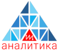

# Коммерческое использование запрещено без лицензии

#№ Коммерческая лицензия CheckAI

Благодарим за интерес к использованию **CheckAI** в коммерческих целях. 

Согласно файлу [LICENSE](LICENSE), бесплатное использование продукта юридическими лицами, включая некоммерческие организации, и индивидуальными предпринимателями запрещено независимо от наличия прибыли. Любое такое использование требует предварительного письменного разрешения правообладателя и приобретения коммерческой лицензии.

## Почему стоимость рассчитывается индивидуально
Продукт CheckAI может применяться в совершенно разных масштабах: от проверки одного личного лендинга до ежесуточного аудита тысяч корпоративных страниц в рамках крупной IT-инфраструктуры. 

Индивидуальный расчет позволяет нам:
* Учесть реальную нагрузку на наши ресурсы и инфраструктуру;
* Предоставить расширенную техническую поддержку и SLA;
* Подготовить юридически корректный договор под ваши бизнес-процессы;
* Предложить специальные условия для Enterprise-уровня (OEM, white-label, приоритетная разработка фич).

## Как получить коммерческую лицензию

Для расчета стоимости и подготовки договора, пожалуйста, отправьте запрос на электронную почту:

**hello@analitica-soft.ru**

**Тема письма:** Коммерческая лицензия CheckAI — [Название вашей компании]

### Что указать в письме
Чтобы мы могли подготовить для вас релевантное предложение, пожалуйста, включите в письмо следующую информацию:

1.  **Полное юридическое лицо:** Название компании, ИНН/КПП.
2.  **Сфера деятельности:** Краткое описание вашего бизнеса (например, e-commerce, SaaS, диджитал-агентство, финтех, медиа).
3.  **Примерное количество сайтов:** Сколько доменов или веб-страниц планируется проверять с помощью CheckAI (диапазон: 1–10, 11–100, 101–1000, более 1000).
4.  **Тип использования:** 
    *   Внутренняя автоматизация (для собственных нужд компании);
    *   Встраивание в ваш платный продукт или SaaS-сервис;
    *   Использование в рамках оказания услуг клиентам (агентская модель).
5.  **Требуемая техническая поддержка:** Нужен ли вам выделенный менеджер, приоритетное время ответа или интеграция в ваши тикет-системы.
6.  **Контактные данные:** ФИО, должность и телефон ответственного лица для связи.

## Что входит в коммерческую лицензию
*   Неисключительное право на использование Продукта в рамках оплаченного объема.
*   Доступ к закрытым минорным обновлениям и патчам безопасности.
*   Приоритетная техническая поддержка по E-mail.
*   Юридическая чистота использования (договор, счета, акты).
*   Возможность продления и масштабирования лицензии.

## Срок рассмотрения
Мы ответим на ваш запрос в течение одного рабочего дня и направим коммерческое предложение с вариантами лицензирования.

Эксклюзивный представитель для поставки коммерческих лицензий - Компания "Аналитика. Проекты и решения" https://analitica-soft.ru (ООО "Аналитика СНГ"), email: hello@analitica-soft.ru

---
*Использование продукта юридическим лицом или индивидуальным предпринимателем без коммерческой лицензии, в том числе некоммерческой организацией, запрещено условиями LICENSE и автоматически прекращает действие лицензии.*
