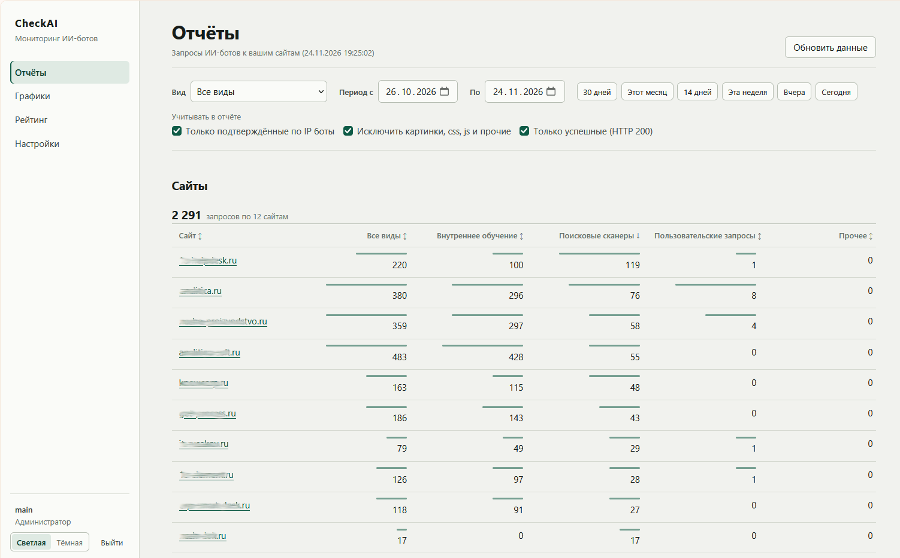

# CheckAI

CheckAI is a service for monitoring AI bot visits to websites. It reads Nginx/Apache2 access logs in `combined` format, identifies known bots, and displays statistics by website, company, bot, and requested page.

The web dashboard and collector run on PHP 8.3, and data is stored in SQLite. CheckAI is designed for website owners and teams who want to understand how AI services access their content.

## Features

- Collection and parsing of Nginx/Apache2 access logs in `combined` format;
- AI bot identification using configurable User-Agent signatures;
- Reports, rankings, and a request log with filters;
- Management of websites, bots, companies, and users through the web dashboard;
- Manual or automatic data collection and daily digests;
- Local data storage in SQLite.

# CheckAI для вашего сервера

CheckAI — сервис для мониторинга обращений ИИ-ботов к сайтам. Он читает access-логи Nginx/Apache2 в формате `combined`, распознаёт известных ботов и показывает статистику по сайтам, компаниям, ботам и запрошенным страницам.

Веб-панель и сборщик работают на PHP 8.3, данные хранятся в SQLite. Проект подходит владельцам сайтов и командам, которым важно понимать, как ИИ-сервисы обращаются к их контенту.

## Возможности

- сбор и разбор access-логов Nginx/Apache2 в формате `combined`;
- распознавание ИИ-ботов по настраиваемым сигнатурам User-Agent;
- отчёты, рейтинги и журнал запросов с фильтрами;
- управление сайтами, ботами, компаниями и пользователями из веб-панели;
- ручной или автоматический сбор данных и ежедневные дайджесты;
- локальное хранение данных в SQLite.


## Демонстрация интерфейса

### Отчёты по сайтам



### Рейтинг обращений ИИ-ботов


### Настройки и каталог ботов


## Условия использования

Физические лица могут бесплатно использовать CheckAI в личных, образовательных и иных некоммерческих целях. Любое использование юридическими лицами, включая НКО, и индивидуальными предпринимателями считается коммерческим независимо от наличия прибыли и требует предварительного письменного разрешения и отдельной платной лицензии.

## Документы проекта

- [Коммерческая лицензия](COMMERCIAL.md)
- [Правила участия в проекте](CONTRIBUTING.md)
- [Уведомления о стороннем ПО](NOTICE.md)
- [Лицензионное соглашение](LICENSE)

## Лицензия

Этот проект распространяется по проприетарной лицензии.

**Бесплатное использование разрешено физическим лицам** только в личных, образовательных или иных некоммерческих целях.

**Любое использование юридическими лицами, включая НКО, и индивидуальными предпринимателями считается коммерческим**, даже если оно не приносит прибыль. Коммерческое использование требует предварительного письменного разрешения и отдельной платной лицензии. К нему также относится применение продукта в составе платных сервисов, для автоматизации бизнеса или в целях извлечения прямой или косвенной прибыли.

Для получения коммерческой лицензии, индивидуальных условий или OEM-интеграции свяжитесь с автором:
* **E-mail:** hello@analitica-soft.ru
* **Telegram:** https://t.me/GregoryR

> *Использование Продукта в нарушение условий данного соглашения автоматически прекращает действие лицензии и может повлечь за собой ответственность согласно законодательству РФ.*

## Быстрый запуск

Для локальной разработки нужен Docker Compose. Из корня проекта выполните:

```bash
docker compose up -d --build
docker compose run --rm admin-setup
```

Затем откройте панель по адресу [http://localhost:555/](http://localhost:555/). По умолчанию Compose ищет журналы в `../logs`; путь к каталогу можно задать переменной `CHECKAI_LOG_DIR`. Для локальной проверки можно создать пустой каталог `../logs` рядом с каталогом проекта.

### Проверка на чистой базе

Команда ниже создаёт новую базу в отдельном временном контейнере и проверяет схему и стартовый справочник. Она не затрагивает локальную базу в `database`:

```bash
docker build -t checkai-ci .
docker run --rm --entrypoint sh checkai-ci -ec 'php bin/init-db.php && php tests/check-clean-db.php'
```

GitHub Actions выполняет эти же команды при каждом push и pull request.

Подробнее об установке, настройке доступа к журналам и устройстве системы — в разделах ниже.

## Размещение

Панель доступна по адресу `https://<you project>/`. Nginx принимает HTTPS и передаёт запросы Apache на `127.0.0.1:81`. Apache использует каталог `public` как корень сайта. В нём находятся точка входа и публичные ресурсы. Конфигурация, сборщик и SQLite находятся вне `public`, в корне проекта и его служебных подкаталогах.

## Установка без Docker

- Нужны PHP 8.3 с PDO SQLite и веб-сервер Apache или Nginx с корнем сайта `public`. Закройте от веб-доступа `src`, `database`, `bin` и каталог `var`.
- Инициализируйте базу командой `php bin/init-db.php`, затем создайте администратора командой `php bin/admin-setup.php`.
- В настройках укажите абсолютный путь к папке логов, доступный пользователю PHP. На Linux PHP должен иметь право прохода (`x`) по каталогу и чтения (`r`) нужных файлов. Например, если Apache работает от `www-data`, а каталог `/var/logs` закрыт для остальных пользователей, выдайте `www-data` право прохода через ACL: `setfacl -m u:www-data:--x /var/logs`. Если сам файл не читается, выдайте ACL на конкретный файл, например `setfacl -m u:www-data:r-- /var/logs/example.com.access.log`. Не открывайте каталог всем пользователям через `chmod 777`.
- Для автоматического сбора добавьте в cron запуск каждые пять минут: `*/5 * * * * /usr/bin/php /path/to/checkai/bin/collect.php --checksettings`. Автосбор включается в настройках.

## Локальный запуск в Docker

- Docker Compose запускается из корня проекта. Адрес панели для локальной разработки — `http://localhost:555/`. Порт контейнера публикуется на `127.0.0.1:555`.
- Путь к образцам логов задаётся переменной `CHECKAI_LOG_DIR` или источником bind-mount в Compose. Внутри контейнеров папка доступна как `/var/logs` только для чтения; этот путь записывается в локальную базу.
- Локальная SQLite хранится в `database/checkai.sqlite3`. Docker Compose подключает каталог `database` к контейнерам по пути `/opt/checkai/var`. В настройках сайта указывается имя файла из примонтированного каталога.


## Сбор логов

- По умолчанию сбор запускается кнопкой «Обновить данные». Администратор может включить автоматический сбор каждые пять минут. Блокировка предотвращает параллельные запуски.
- Сборщик читает стандартные access-логи Nginx/Apache2 в формате `combined`. Корень логов задаётся в разделе «Настройки» и хранится в SQLite отдельно для каждой установки. Для новых баз значение по умолчанию — `/var/logs`; его можно изменить на путь, доступный PHP. Для каждого сайта указывается путь к файлу относительно корня, например `yoursite.com.access.log`.
- При добавлении сайта приложение проверяет, что файл существует внутри корня логов. Проверяйте доступ от имени пользователя PHP: `runuser -u www-data -- test -r /var/logs/yoursite.com.access.log && echo readable || echo not-readable`. Если файл существует, но проверка не проходит, проверьте права на каждый каталог пути (`namei -l /var/logs/yoursite.com.access.log`): для прохода нужен `x` на каталогах, для чтения — `r` на файле. На VPS право прохода по закрытому каталогу можно дать через ACL без разрешения просматривать его содержимое.
- При первом подключении сборщик читает текущий файл с начала. При следующих запусках продолжает с сохранённой позиции. Незавершённая строка остаётся до следующего запуска. События и курсор сохраняются в одной транзакции.
- После ротации сборщик дочитывает старый файл с сохранённой позиции, пока файл доступен в несжатом виде. Идентификаторы файловой системы и файла (`device` и `inode`) помогают различать старый и новый файлы. Новый файл читается с нуля. Если старый файл уже упакован в ZIP или недоступен, сборщик продолжает с нового файла.
- User-Agent сравнивается с активными сигнатурами без учёта регистра. При нескольких совпадениях применяется самая длинная сигнатура. Сохраняется одно событие. Изменения сигнатур применяются к ещё не обработанным строкам.

## Структура SQLite

| Таблица | Основные поля | Назначение |
| --- | --- | --- |
| `settings` | `id`, `log_root`, `report_timezone` | Общие настройки, одна строка. |
| `sites` | `id`, `domain`, `log_path`, `enabled` | Сайты с уникальными доменами. Для каждого сайта задан путь к логу. |
| `companies` | `id`, `name`, `description` | Настраиваемый справочник компаний с уникальными названиями и описанием. |
| `bot_types` | `id`, `name` | Виды ботов: сборщики данных для обучения, поисковые сканеры, пользовательские запросы и прочее. |
| `bots` | `id`, `company_id`, `bot_type_id`, `name`, `enabled` | Боты с обязательной привязкой к компании и виду. Имя уникально в пределах компании. |
| `bot_signatures` | `id`, `bot_id`, `pattern`, `enabled` | Одна или несколько сигнатур User-Agent на бота. Сигнатуры уникальны без учёта регистра. |
| `requests` | `id`, `site_id`, `bot_id`, `requested_at_utc`, `method`, `request_path`, `http_status` | Журнал распознанных запросов. |
| `log_cursors` | `id`, `site_id`, `device`, `inode`, `byte_offset`, `updated_at_utc` | Позиция чтения для каждого поколения файла сайта. |
| `users` | `id`, `login`, `password_hash`, `role`, `enabled`, `needs_password`, `created_at_utc` | Учётные записи с уникальными логинами и ролями `admin` или `user`. |

SQLite работает в режиме WAL с включёнными внешними ключами. Для журнала нужны индексы по времени, сайту и времени, боту и времени. Время запроса берётся из access-лога и приводится к UTC, путь сохраняется без query string. Подробные события хранятся 30 дней. Сводка строится по журналу через связь бота с компанией.

## Первоначальное заполнение справочника

При инициализации новой SQLite загрузить стартовый справочник из версионируемых файлов проекта. В одной транзакции создать виды ботов, компании, привязать к ним ботов и добавить активные сигнатуры User-Agent. Для новых ботов начальным видом служит «Прочее»; администратор может изменить его в карточке бота. Стартовый набор из спецификации проекта:

| Компания | Боты и начальные сигнатуры User-Agent |
| --- | --- |
| OpenAI | `GPTBot`, `OAI-SearchBot`, `ChatGPT-User`, `OAI-AdsBot` |
| Anthropic | `ClaudeBot`, `Claude-SearchBot`, `Claude-User` |
| Perplexity | `PerplexityBot`, `Perplexity-User` |
| DeepSeek | `DeepSeek-Harness` (сигнатура `deepseek-harness`) |
| Google | `Google-CloudVertexBot` |
| Amazon | `Amazonbot`, `Amzn-SearchBot`, `Amzn-User` |

При переносе справочника прототипа также включить ByteDance (`Bytespider`) и Common Crawl (`CCBot`). По умолчанию имя бота служит начальной строкой поиска в User-Agent; исключения хранятся в `database/bot-signatures.php`. В карточке бота администратор может редактировать список сигнатур, по одной на строку.

Отметку об успешной загрузке записать в той же транзакции. Повторный запуск инициализации использует эту отметку, чтобы избежать дублей и сохранить изменения администратора. После установки справочник можно дополнять через панель.


## Панель и учётные записи

Панель показывает отчёты и отдельный рейтинг запросов по компаниям, ботам и сайтам. Рейтинг сортируется по числу запросов по убыванию и использует те же фильтры периода и вида обращения, что и отчёты. В журнале видны время обращения, сайт, бот, HTTP-метод, запрошенный путь и код ответа. Часовой пояс отчётов по умолчанию — `Asia/Yekaterinburg`.

- **Администратор** просматривает отчёты и журнал, управляет пользователями, сайтами, путями к логам, компаниями, ботами и сигнатурами. Пользователя можно отключить в списке учётных записей; отключённый пользователь не может войти. Нельзя отключить единственного активного администратора.
- Корень каталога логов настраивается администратором в разделе «Настройки»; путь должен существовать и быть доступен приложению.
- **Пользователь** просматривает отчёты и журнал по всем подключённым сайтам, но не имеет доступа к настройкам и изменению данных.
- Администратор создаёт учётные записи с ролью пользователя или администратора. При первом входе новый пользователь задаёт пароль; после сброса администратором пароль задаётся заново при следующем входе.

После инициализации SQLite первый администратор создаётся интерактивной серверной командой. Для Docker Compose:

```bash
docker compose run --rm admin-setup
```

Команда запрашивает логин, пароль и его подтверждение. Ввод пароля скрыт. В базе сохраняется хеш, созданный через PHP `password_hash()`. Первичная настройка доступна, пока в базе нет администратора. Для восстановления доступа предусмотрена отдельная серверная команда смены пароля. Остальные учётные записи администратор создаёт в панели.

## Ежедневные дайджесты

Администратор может сформировать дайджест вручную в **Настройки → Дайджесты**. Скрипт и кнопка формируют отчёт за предыдущий календарный день. В дайджест попадают активные сайты и разбивка по всем видам ботов; отключённые боты и компании исключаются. Итоги по всем сайтам приводятся в конце.

Файлы создаются в каталоге, заданном в настройках («Дайджесты»), с именем `YYYYMMDD-HH-MM_digest.txt`, где дата и время в имени соответствуют времени запуска. Файл не перезаписывается, если за ту же минуту уже создан дайджест. Каталог должен существовать и быть доступен для записи PHP. Для ручного запуска без Docker:

```bash
sudo install -d -o www-data -g www-data -m 0750 /path/to/checkai/digests
sudo -u www-data /usr/bin/php /path/to/checkai/bin/generate-digest.php
```

В настройках включите флажок «Ежедневный дайджест» и нажмите «Сохранить настройки», чтобы разрешить автоматическое формирование. По умолчанию флажок выключен. В Docker Compose дайджест запускается каждый день в 01:00 отдельным сервисом `digest-scheduler`; выключенный флажок пропускает генерацию. Сервис использует ту же базу и каталог `digests`, что и веб-приложение. После изменения конфигурации запустите `docker compose up -d --build`.

При запуске без Docker настройте cron пользователя веб-сервера:

```bash
sudo crontab -u www-data -e
```

Включите флажок «Ежедневный дайджест» в настройках и добавьте строку (замените путь к проекту, если он отличается):

```cron
0 1 * * * /usr/bin/php /path/to/checkai/bin/generate-digest.php
```

В Docker Compose папка проекта `digests` подключена к каталогу по умолчанию в контейнере веб-приложения. На сервере без Docker создайте каталог `digests` в каталоге проекта и выдайте пользователю PHP права на запись.

## Оформление панели

Разметка — `public/index.php` (каркас, вход, настройки), отчёты — `src/report.php`, компании и карточка бота — `src/bot-settings.php`. Настройки разделены на «Сайты» и «Боты»: в разделе «Боты» сначала показан список компаний, затем боты выбранной компании и карточка бота. Оформление вынесено в `public/app.css`: дизайн-токены в `:root`, отдельные значения для светлой и тёмной темы через `prefers-color-scheme`. Поведение — `public/settings.js` (подстановка пути к логу, подтверждение удаления), `public/report-filters.js` (перезапрос отчёта при смене фильтров), `public/app.js` (состояние отправки формы).

Сторонних библиотек и внешних шрифтов нет: политика `default-src 'self'` разрешает только файлы сайта, встроенных `<style>` и `style="..."` в разметке нет. Числовые колонки и таблицы используют системный моноширинный шрифт и `tabular-nums`. Выбранные фильтры отчёта попадают в адрес страницы, поэтому ссылкой можно поделиться. Ссылки на стили и скрипты содержат версию файла (`?v=` по времени изменения), чтобы браузер не держал старые файлы после обновления панели.

Автор репозитория: Григорий Русаков Эксперт в ИТ и ИИ https://it-rusakov.ru email: greg@it-rusakov.ru Компания Аналитика. Проекты и решения https://analitica-soft.ru (внедрение ИТ и ИИ технологии).
