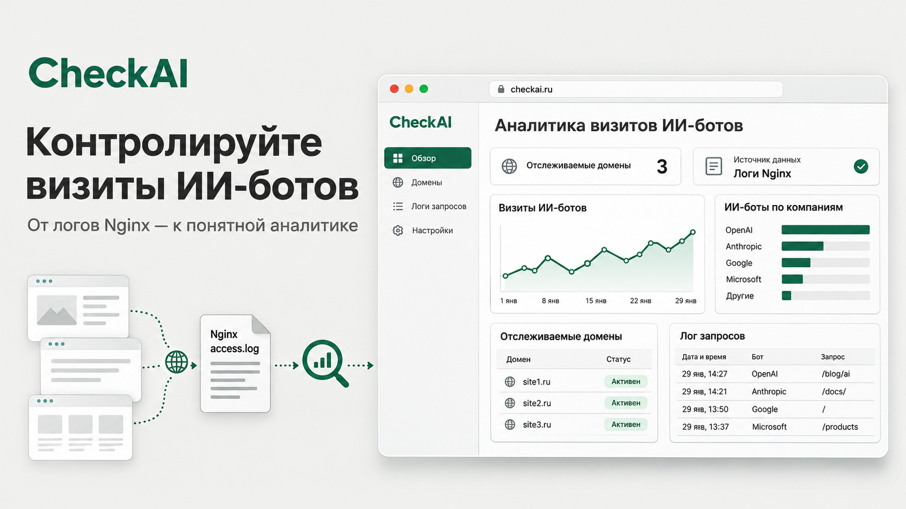
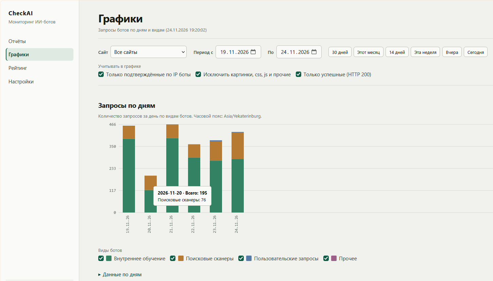
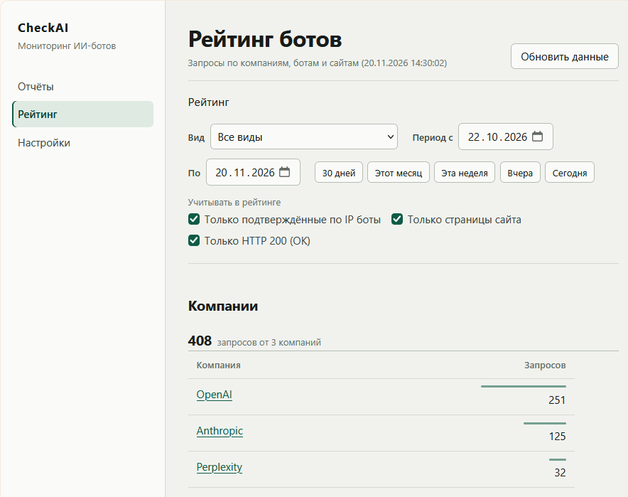
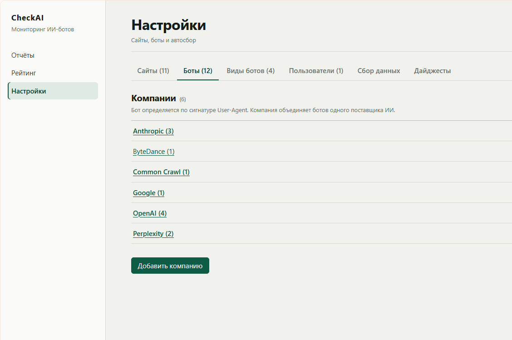

# CheckAI

CheckAI is a service for monitoring AI bot visits to websites. It reads Nginx/Apache2 access logs in `combined` format, identifies known bots, and displays statistics by website, company, bot, and requested page.

The web dashboard and collector run on PHP 8.3, and data is stored in SQLite. CheckAI is designed for website owners and teams who want to understand how AI services access their content.

## Features

- Collection and parsing of Nginx/Apache2 access logs in `combined` format;
- AI bot identification using configurable User-Agent signatures;
- Reports, rankings, and a request log with filters;
- Management of websites, bots, companies, and users through the web dashboard;
- Manual or automatic data collection and daily digests;
- Local data storage in SQLite.

# CheckAI для вашего сервера

CheckAI — сервис для мониторинга обращений ИИ-ботов к сайтам. Он читает access-логи Nginx/Apache2 в формате `combined`, распознаёт известных ботов и показывает статистику по сайтам, компаниям, ботам и запрошенным страницам.

Веб-панель и сборщик работают на PHP 8.3, данные хранятся в SQLite. Проект подходит владельцам сайтов и командам, которым важно понимать, как ИИ-сервисы обращаются к их контенту.

## Возможности

- сбор и разбор access-логов Nginx/Apache2 в формате `combined`;
- распознавание ИИ-ботов по настраиваемым сигнатурам User-Agent;
- отчёты, рейтинги и журнал запросов с фильтрами;
- управление сайтами, ботами, компаниями и пользователями из веб-панели;
- ручной или автоматический сбор данных и ежедневные дайджесты;
- локальное хранение данных в SQLite.

## Демонстрация интерфейса

### Отчёты по сайтам

### Наглядные графики

### Рейтинг обращений ИИ-ботов

### Настройки и каталог ботов

## Условия использования

Физические лица могут бесплатно использовать CheckAI в личных, образовательных и иных некоммерческих целях. Любое использование юридическими лицами, включая НКО, и индивидуальными предпринимателями считается коммерческим независимо от наличия прибыли и требует предварительного письменного разрешения и отдельной платной лицензии.

## Документы проекта

- [Техническая документация](TECHNICAL.md)
- [Безопасность](SECURITY.md)
- [Решения и состояние проекта](DECISIONS.md)
- [Шаблон Pull Request](.github/PULL_REQUEST_TEMPLATE.md)
- [Коммерческая лицензия](COMMERCIAL.md)
- [Правила участия в проекте](CONTRIBUTING.md)
- [Уведомления о стороннем ПО](NOTICE.md)
- [Лицензионное соглашение](LICENSE)

## Лицензия

Этот проект распространяется по проприетарной лицензии.

**Бесплатное использование разрешено физическим лицам** только в личных, образовательных или иных некоммерческих целях.

**Любое использование юридическими лицами, включая НКО, и индивидуальными предпринимателями считается коммерческим**, даже если оно не приносит прибыль. Коммерческое использование требует предварительного письменного разрешения и отдельной платной лицензии. К нему также относится применение продукта в составе платных сервисов, для автоматизации бизнеса или в целях извлечения прямой или косвенной прибыли.

Для получения коммерческой лицензии, индивидуальных условий или OEM-интеграции свяжитесь с автором:
* **E-mail:** hello@analitica-soft.ru
* **Telegram:** https://t.me/GregoryR

> *Использование Продукта в нарушение условий данного соглашения автоматически прекращает действие лицензии и может повлечь за собой ответственность согласно законодательству РФ.*

## Установка и техническая документация

Инструкции по установке, настройке и устройству системы находятся в [технической документации](TECHNICAL.md).

Автор репозитория: Григорий Русаков - Эксперт в ИТ и ИИ https://it-rusakov.ru email: greg@it-rusakov.ru 
Эксклюзивный представитель для поставки коммерческих лицензий - Компания "Аналитика. Проекты и решения" https://analitica-soft.ru (ООО "Аналитика СНГ"), email: hello@analitica-soft.ru
